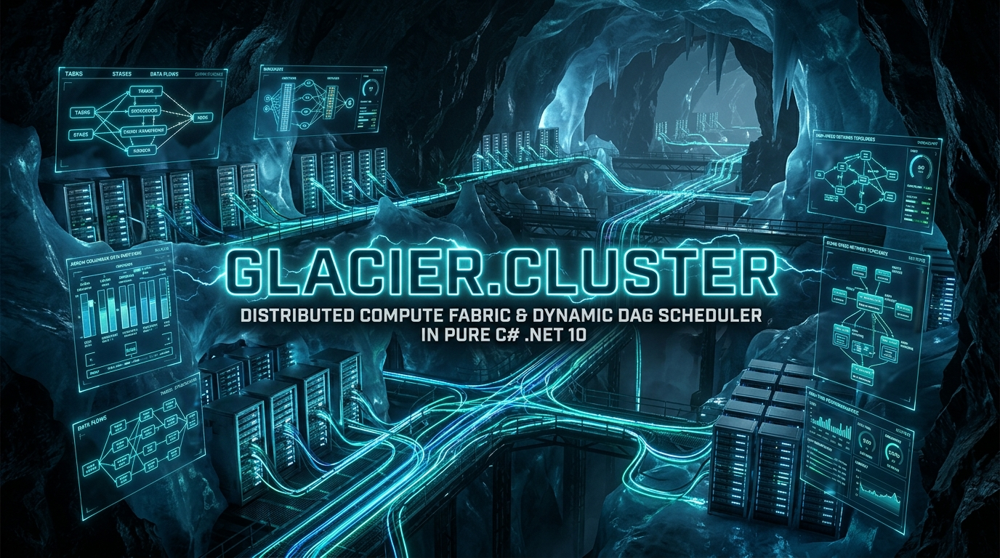

# Glacier.Cluster

[](LICENSE)
[](https://dotnet.microsoft.com/)
[](https://learn.microsoft.com/en-us/dotnet/core/deploying/native-aot/)
[](https://glaciersoftware.dev/)

`Glacier.Cluster` is a distributed compute runtime, DAG scheduler, and multi-node pipeline library for .NET 10. It connects worker processes over `System.IO.Pipelines` framing to run distributed `Glacier.Polaris` queries, Ring AllReduce collectives, and multi-stage model inference.

It targets distributed .NET services that need typed binary protocols, Arrow IPC partition shuffles, failure detection, and in-memory multi-node fault simulation under Native AOT without JVM or C++ runtime dependencies.

## Install

```powershell
dotnet add package Glacier.Cluster
```

## Quick Start

```csharp
using System.Net;
using Glacier.Cluster.Coordinator;
using Glacier.Cluster.Polaris;
using Glacier.Cluster.Worker;

string clusterSecret = Environment.GetEnvironmentVariable("GLACIER_CLUSTER_SECRET") ?? string.Empty;

await using var coordinator = new ClusterCoordinator(new ClusterCoordinatorOptions
{
    BindAddress = IPAddress.Loopback,
    Port = 51000,
    ClusterSecret = clusterSecret
});
await coordinator.StartAsync();

await using var worker = new ClusterWorker(new ClusterWorkerOptions
{
    CoordinatorEndPoint = new IPEndPoint(IPAddress.Loopback, 51000),
    ShufflePort = 51002,
    ClusterSecret = clusterSecret
});
await worker.StartAsync();

// Execute a distributed query plan across registered worker partitions:
using var ddf = DistributedDataFrameFactory.FromPartitions(partitions);
var summary = await ddf
    .Filter("age > 30")
    .Select("dept", "salary")
    .GroupBy("dept")
    .Sum("salary")
    .CollectAsync();
```

## What You Can Do

- **Coordinate worker nodes (`ClusterCoordinator` & `ClusterWorker`):** Authenticate joins with constant-time SHA-256 `ClusterSecret` comparison, probe worker CPU/SIMD/GPU capabilities (`NodeHardwareProfile.ProbeLocal`), and track liveness via `PhiAccrualFailureDetector`.
- **Schedule hardware-aware DAGs (`TwoPhaseScheduler` & `StageCompiler`):** Filter nodes by memory and accelerator capability, score affinity across queue depth and SIMD tier, and hash-route partitions with XXHash3 Lemire reduction.
- **Shuffle Arrow IPC partitions (`ArrowShuffleServer` & `ArrowShuffleClient`):** Stream `Glacier.Formats` / `Glacier.Polaris` batches across workers with 64-byte aligned reference-counted buffers, credit-based flow control, and `DiskSpillManager`.
- **Run distributed queries & collectives (`DistributedDataFrame`, `DistributedKMeans`, `RingAllReduceCoordinator`):** Run `Filter`, `Select`, `GroupBy`, `Join`, `Repartition`, K-Means fitting, and ring scatter-reduce / allgather across physical sockets or the in-memory `ClusterSimulator`.
- **Pipeline inference across nodes (`DistributedPipelineCoordinator` & `DistributedClusterSession`):** Balance transformer layers across heterogeneous GPUs and warm CPU expert pools (`ClusterResourcePlanner`, `HeterogeneousLoadBalancer`, `SpeculativeOverlapCoordinator`).

## Platform & Compatibility

`Glacier.Cluster` targets `.NET 10` (`net10.0`) with `<IsAotCompatible>true</IsAotCompatible>`, `<EnableTrimAnalyzer>true</EnableTrimAnalyzer>`, and source-generated `ClusterJsonContext`.

## Documentation

- [User Manual](docs/manual.md) — Coordinator/worker setup, scheduler, Arrow IPC shuffle, `DistributedDataFrame`, Ring AllReduce, and `ClusterSimulator`
- [Distributed Inference Manual](docs/manual/distributed-inference.md) — Stage workers, heterogeneous load balancing, dynamic calibration, and speculative pipeline execution
- [Architecture](docs/architecture.md) — `GCLU` wire framing, two-phase scheduling, active-standby ledger, failure detection, and shuffle memory model

## License & Credits

Licensed under the [MIT License](LICENSE).

Developed by Ian Cowley, Antigravity (Google DeepMind) and Claude.
