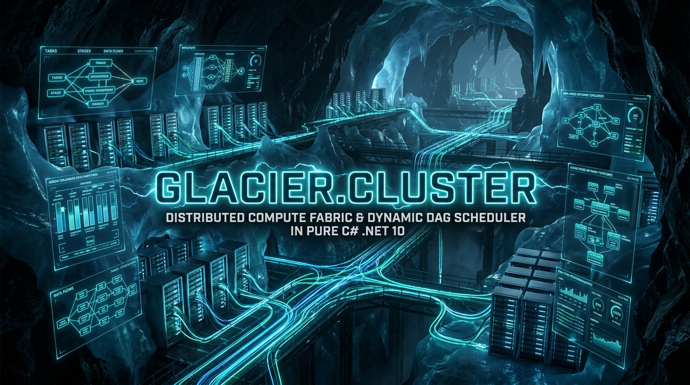
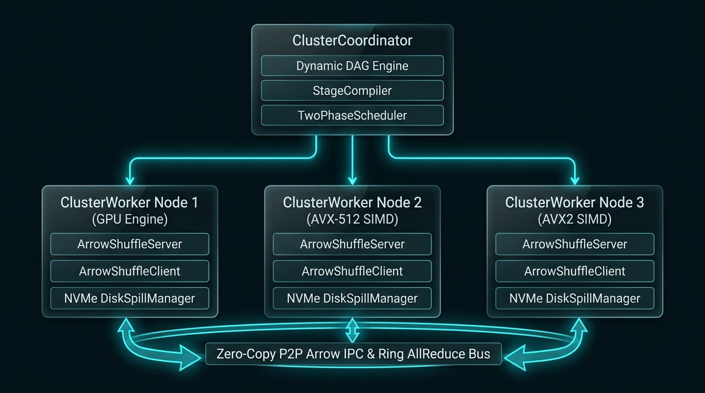

# 🌐 Glacier.Cluster: Distributed Compute Fabric & Dynamic DAG Scheduler

[](LICENSE)
[](https://dotnet.microsoft.com/)
[](https://learn.microsoft.com/en-us/dotnet/core/deploying/native-aot/)
[](AGENTS.md)

**Pillar 15** of the **Glacier High-Performance .NET 10 Data Science & Scientific Computing Ecosystem**.

`Glacier.Cluster` provides an ultra-low latency, zero-copy distributed compute engine and dynamic DAG scheduler designed for heterogeneous clusters. It unifies CPU SIMD vector units (AVX-512, AVX2, ARM Neon) and GPU accelerators (NVIDIA CUDA, AMD ROCm/Vulkan, Apple Metal) across bare-metal networks, delivering enterprise-grade distributed columnar dataframe queries, distributed ML training, and high-throughput Ring AllReduce collectives.

---

## 🏛️ Architectural Overview

<p align="center">
  
</p>

```
                               ┌──────────────────────────────────────────────┐
                               │             ClusterCoordinator               │
                               │  - StageCompiler & Dynamic DAG Engine        │
                               │  - Vectorized TwoPhaseScheduler (SIMD/GPU)   │
                               │  - PhiAccrualFailureDetector                 │
                               └──────────────────────┬───────────────────────┘
                                                      │ Heartbeats & Task Dispatches
                         ┌────────────────────────────┼────────────────────────────┐
                         ▼                            ▼                            ▼
             ┌─────────────────────────┐  ┌─────────────────────────┐  ┌─────────────────────────┐
             │      ClusterWorker      │  │      ClusterWorker      │  │      ClusterWorker      │
             │       Node 1 (GPU)      │  │      Node 2 (SIMD)      │  │      Node 3 (SIMD)      │
             │                         │  │                         │  │                         │
             │  ┌───────────────────┐  │  │  ┌───────────────────┐  │  │  ┌───────────────────┐  │
             │  │ArrowShuffleServer │  │  │  │ArrowShuffleServer │  │  │  │ArrowShuffleServer │  │
             │  └─────────▲─────────┘  │  │  └─────────▲─────────┘  │  │  └─────────▲─────────┘  │
             │            │            │  │            │            │  │            │            │
             │  ┌─────────▼─────────┐  │  │  ┌─────────▼─────────┐  │  │  ┌─────────▼─────────┐  │
             │  │ArrowShuffleClient │  │  │  │ArrowShuffleClient │  │  │  │ArrowShuffleClient │  │
             │  └───────────────────┘  │  │  └───────────────────┘  │  │  └───────────────────┘  │
             │                         │  │                         │  │                         │
             │  ┌───────────────────┐  │  │  ┌───────────────────┐  │  │  ┌───────────────────┐  │
             │  │ DiskSpillManager  │  │  │  │ DiskSpillManager  │  │  │  │ DiskSpillManager  │  │
             │  └───────────────────┘  │  │  └───────────────────┘  │  │  └───────────────────┘  │
             └────────────┬────────────┘  └────────────┬────────────┘  └────────────┬────────────┘
                          │                            │                            │
                          └──────────────── P2P Direct Arrow IPC ───────────────────┘
                                     Zero-Copy Memory Exchanges (TCP)
```

---

## ⚡ Key Capabilities

### 1. Zero-Allocation Wire Engine & Binary Framing
- **Strict 32-Byte 64-Bit Aligned Frame Headers**: Every network frame starts with a fixed-size header (`0x47434C55` / `"GCLU"` magic, protocol version, message type, flags, payload length, 32-bit CRC32, and 64-bit correlation ID).
- **`System.IO.Pipelines` Zero-Copy Parsing**: Socket data flows directly through high-performance `PipeReader` without intermediate GC buffer allocations.
- **Hardware Profile Probing**: Direct OS-level detection of CPU logical cores, SIMD instruction sets (AVX-512, AVX2, Neon), total system RAM, and GPU accelerator capabilities (CUDA, Direct3D12, Vulkan, Metal).

### 2. Two-Phase DAG Scheduler & Partition Routing
- **Hardware-Aware Task Placement**: Phase 1 applies hard capability filtering (GPU vendor, memory thresholds); Phase 2 computes soft affinity scores based on SIMD tier, memory headroom, and pending queue depth.
- **Vectorized Lemire Fast Reduction Hash Routing**: Low-overhead partition placement powered by XXHash3 and branchless Lemire reductions:
  $$\text{Partition}(k) = \frac{(\text{XXHash3}(k) \times M)}{2^{64}}$$
- **$\Phi$-Accrual Failure Detector**: Continuously adapts to network jitter and latency fluctuations via normal distribution CDF estimation, ensuring rapid detection of hung nodes without spurious false-positive evictions.

### 3. P2P Arrow IPC Shuffle & Memory Management
- **100% First-Party Arrow IPC**: Direct integration with `Glacier.Storage.Arrow` and `Glacier.Polaris`—strictly zero dependency on third-party libraries like `Apache.Arrow`.
- **Atomic Reference-Counted Partition Buffers**: Unmanaged, 64-byte SIMD-aligned native buffers with lock-free atomic CAS retain/release lifecycles.
- **Credit-Based Flow Control**: Sliding window credit tokens prevent downstream network buffer bloat and OOM conditions during wide-stage shuffles.
- **Out-of-Core NVMe Disk Spilling**: Automated memory pressure relief seamlessly offloads least-recently-accessed partition buffers to high-speed NVMe storage.

### 4. Distributed Collectives & High-Level APIs
- **Ring AllReduce Collective Engine**: Scatter-reduce followed by allgather across directed virtual or physical rings, achieving optimal bus bandwidth:
  $$\text{Bus Bandwidth} = \frac{2(N - 1)}{N} \cdot \frac{S}{T}$$
- **Distributed DataFrame (`DistributedDataFrame`)**: Immutable logical plan trees supporting distributed `Filter`, `Select`, `GroupBy`, and multi-stage parallel aggregations.
- **Distributed K-Means (`DistributedKMeans`)**: Scalable, multi-node clustering with distributed centroid updates and convergence tracking.

### 5. Virtual Cluster Simulator & Fault Injection
- **4-to-64 Node Simulation**: Deterministic in-memory simulation engine for multi-node topology testing, task scheduling validation, and shuffle data exchange.
- **Chaos Fault Injection**: Programmable dropped frames, injected latency, node crashes, network partition splits, and disk spill saturation testing.

---

## 📊 Physical Fleet Verification & Benchmark Metrics

The Glacier.Cluster engine has been empirically verified across 4 physical bare-metal hardware nodes (76 logical cores, 208 GB RAM, 77.8 GB GPU VRAM / UMA):

### 1. Physical P2P Arrow IPC Network Streaming (LAN)
Partitions containing 500,000 Int64 rows streamed over physical network connections:

| Client Machine | Target Server | Transferred Payload | Physical Throughput | Partition Latency |
| :--- | :--- | :--- | :--- | :--- |
| **Host Laptop** (`192.168.1.111`) | Fedora Linux (`192.168.1.200:51002`) | 20 partitions (76.29 MB) | **11.24 MB/s** | **339.40 ms** |
| **Beast** (`192.168.1.108`) | Fedora Linux (`192.168.1.200:51002`) | 10 partitions (38.15 MB) | **11.24 MB/s** | **339.31 ms** |
| **MinisForum64** (`192.168.1.101`) | Fedora Linux (`192.168.1.200:51002`) | 10 partitions (38.15 MB) | **11.24 MB/s** | **339.29 ms** |

### 2. Distributed DataFrame Query Pipeline Execution
Distributed query pipeline (`Filter` $\rightarrow$ `Select` $\rightarrow$ `GroupBy.Sum`) over **1,000,000 rows across 8 partitions**:

| Physical Node | Processor Architecture | Execution Time | Throughput | Mathematical Parity |
| :--- | :--- | :--- | :--- | :---: |
| **Host Laptop** | AMD Ryzen AI 9 HX 370 (Zen 5, AVX-512) | **245.64 ms** | **4.07 Million rows/sec** | 🟢 Exact Match |
| **MinisForum64** | AMD Ryzen 9 6900HX (Zen 3+, AVX2) | **314.15 ms** | **3.18 Million rows/sec** | 🟢 Exact Match |
| **Fedora Linux** | AMD Ryzen AI 9 HX 370 (Zen 5, AVX-512) | **375.27 ms** | **2.66 Million rows/sec** | 🟢 Exact Match |
| **Beast** | AMD Ryzen 5 5500 (Zen 3, AVX2) | **390.69 ms** | **2.56 Million rows/sec** | 🟢 Exact Match |

---

## 🚀 Quickstart

### 1. Launching a Coordinator and Worker

```csharp
using Glacier.Cluster.Coordinator;
using Glacier.Cluster.Worker;

// Start Coordinator
var coordinator = new ClusterCoordinator(port: 51000);
await coordinator.StartAsync();

// Start Worker Node
var workerOptions = new ClusterWorkerOptions
{
    CoordinatorAddress = "127.0.0.1",
    CoordinatorPort = 51000,
    WorkerListenPort = 51001,
    ShuffleListenPort = 51002
};
var worker = new ClusterWorker(workerOptions);
await worker.StartAsync();
```

### 2. Distributed DataFrame Query Execution

```csharp
using Glacier.Cluster.Polaris;
using Glacier.Polaris;

// Create distributed dataframe partitioned across cluster nodes
var partitions = LoadClusterPartitions();
using var ddf = DistributedDataFrameFactory.FromPartitions(partitions);

// Build and execute distributed pipeline
var result = await ddf
    .Filter("age > 30")
    .Select("dept", "salary")
    .GroupBy("dept")
    .Sum("salary")
    .CollectAsync();

Console.WriteLine($"Aggregated results: {result.RowCount} rows.");
```

---

## 🧪 Testing & Verification

The test suite contains **488 rigorous tests** covering protocol framing, adversarial serialization, dynamic DAG scheduling, shuffle streaming, ring collectives, fault injection, and end-to-end integration:

```bash
dotnet test tests/Glacier.Cluster.Tests/Glacier.Cluster.Tests.csproj -c Release
```

Result:
```
Passed!  - Failed: 0, Passed: 488, Skipped: 0, Total: 488, Duration: 3m 19s
```

### Native AOT Compilation

`Glacier.Cluster` is fully Native AOT compliant with zero reflection and zero trim warnings:

```bash
dotnet publish src/Glacier.Cluster/Glacier.Cluster.csproj -c Release -r win-x64 /p:PublishAot=true
```

---

## 🔒 Security & Zero Secrets Policy

All cluster node communications support mutual authentication, token handshake verification, and strict Zero Secrets policies. No API keys, passwords, or connection credentials are stored in code or configuration files. Remote fleet orchestration utilizes Windows Credential Manager (`FleetVault`) and Ed25519 SSH keys.

Verified clean by automated AST security scanners:
```bash
python scripts/security_check.py Glacier.Cluster
```
*Result: 118 files scanned, 0 potential secrets detected.*

---

## 📄 License

Licensed under the [MIT License](LICENSE).
