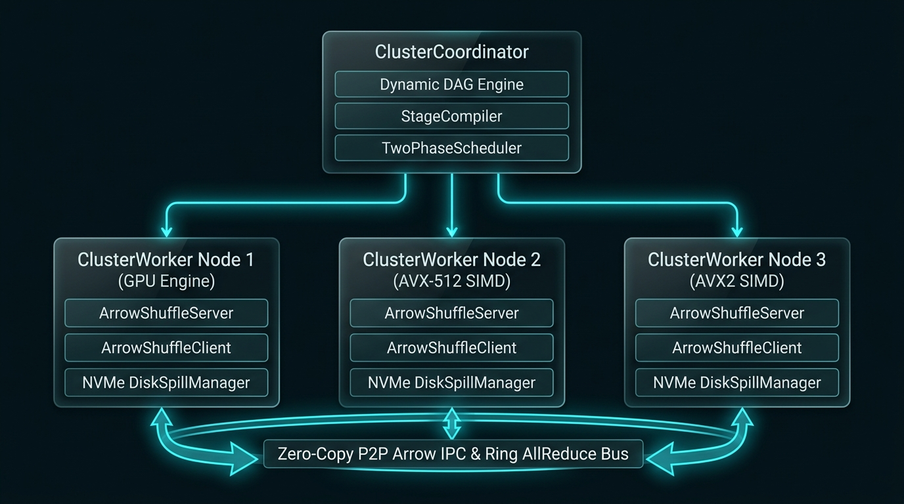
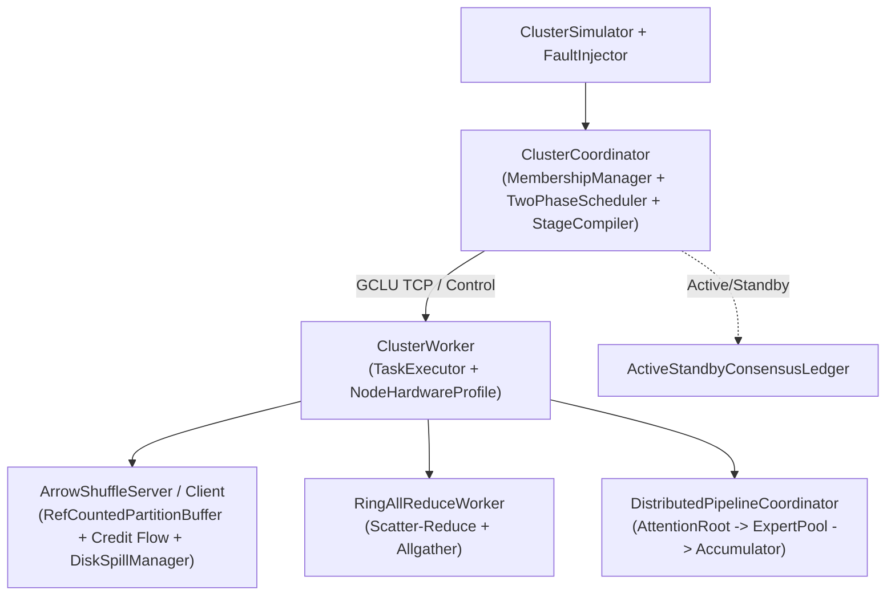

# Glacier.Cluster Architecture

`Glacier.Cluster` organizes distributed compute around five planes: zero-copy socket framing, membership and active-standby coordination, hardware-aware DAG scheduling, reference-counted Arrow IPC shuffling, and multi-stage inference orchestration.

## 1. Component Overview

## 2. Wire Protocol & Framing (`Glacier.Cluster.Protocol` & `Transport`)

Every control and transport packet begins with a fixed **32-byte 64-bit aligned `GCLU` header** (`0x47434C55`), encoding protocol version, message type, flags (`ClusterFrameFlags`), payload length, CRC-32 (`ClusterCrc32`), and a 64-bit correlation ID. `ClusterFrameReader` parses headers and frames directly out of `System.IO.Pipelines` `PipeReader` buffers (`DuplexPipeFactory`, `SocketDuplexPipe`), paired with `PinnedBatchBufferArena` / `PinnedSocketBufferPool` and optional `SimdXorDeltaCodec` XOR delta compression. Control DTOs serialize cleanly under Native AOT via `ClusterJsonContext`.

When `ClusterSecret` is set on `ClusterCoordinatorOptions` and `ClusterWorkerOptions`, node join authentication hashes the secret with SHA-256 and checks tokens in constant time.

## 3. Scheduling, Membership & Failure Detection

- **`TwoPhaseScheduler`:** Phase 1 filters eligible workers against hard constraints (accelerator availability, RAM headroom, SIMD tier). Phase 2 ranks surviving nodes using soft affinity across pending task depth and hardware capacity.
- **`PartitionRouter`:** Maps partition keys using XXHash3 + Lemire fast range reduction: $\text{Partition}(k) = (\text{XXHash3}(k) \times M) / 2^{64}$.
- **`PhiAccrualFailureDetector`:** Tracks inter-arrival heartbeat history (`HeartbeatHistoryWindow`) and scores node liveness via normal-distribution tail probabilities so transient network jitter does not evict healthy workers.
- **`ActiveStandbyConsensusLedger`:** Replicates job/lineage metadata to peer coordinator endpoints (`ConsensusRole`) when `EnableConsensusReplication` is enabled.

## 4. P2P Arrow IPC Shuffle & Ring AllReduce

- **First-Party Arrow IPC:** `ArrowIpcStreamSerializer` and `ArrowIpcZeroCopyReader` encode and slice `Glacier.Polaris` partitions directly via `Glacier.Formats` with zero external Arrow packages.
- **Bounded Memory & Spill:** `RefCountedPartitionBuffer` manages 64-byte aligned unmanaged blocks with atomic retain/release counts, `FlowControlCreditManager` backpressures senders, and `DiskSpillManager` evicts cold partitions to temporary NVMe storage.
- **Ring AllReduce (`RingAllReduceCoordinator`):** Orders peers by subnet (`OrderNodesTopologyAware`) and performs scatter-reduce plus allgather with bus bandwidth $\frac{2(N - 1)}{N} \cdot \frac{S}{T}$.
